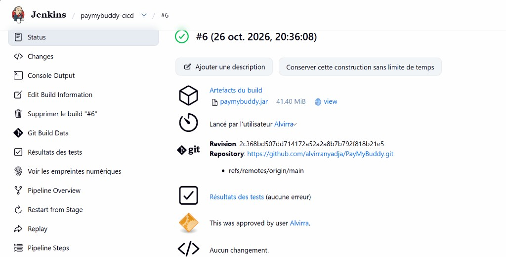
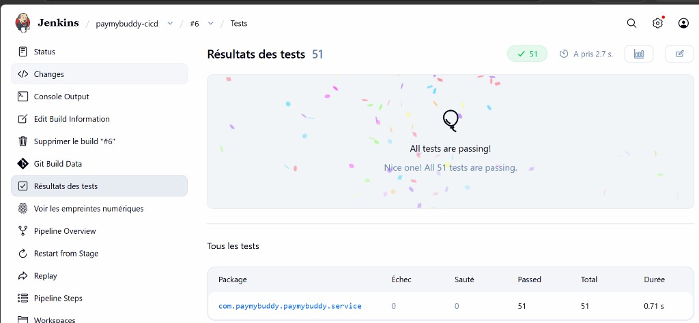
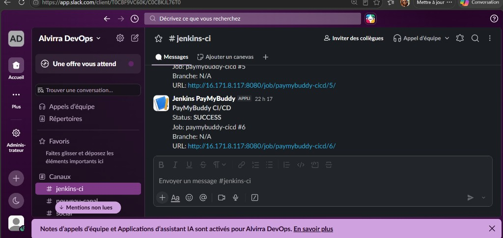
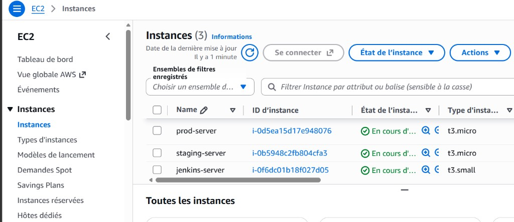
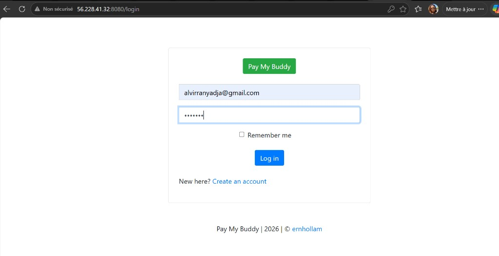
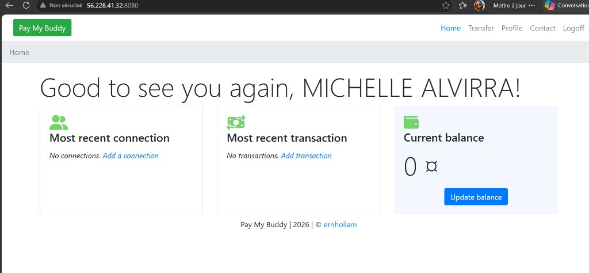
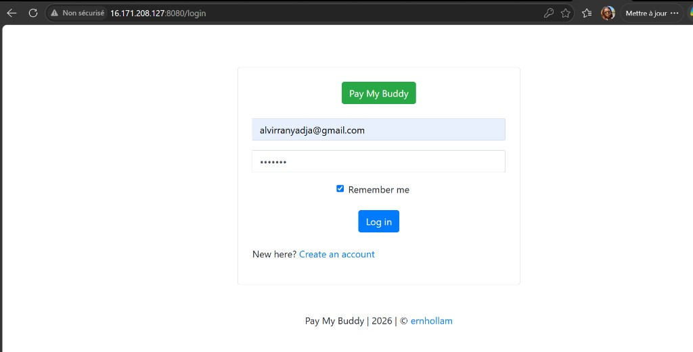

# Mini-projet Jenkins CI/CD — PayMyBuddy

Pipeline Jenkins pour l’application Spring Boot [PayMyBuddy](https://github.com/alvirranyadja/PayMyBuddy), avec agents Docker, SonarCloud, Docker Hub, déploiement SSH staging/prod et notification Slack.

## Prérequis (déjà préparés)

| Élément | Valeur |
|---------|--------|
| Jenkins | http://51.20.191.244:8080 |
| Staging | `56.228.41.32:8080` |
| Prod | IP publique EC2 (change après Stop/Start sans Elastic IP) |
| Docker Hub | `alvirra/paymybuddy` |
| SonarCloud | org/key `alvirranyadja` |
| Credentials | `dockerhub-credentials`, `ssh-deploy`, `sonar-token`, `slack-webhook` |

## Structure

```text
mini-projet-jenkins/
├── Jenkinsfile                 # Pipeline CI/CD
├── agent/Dockerfile            # Agent CI (Maven 17 + Docker CLI + SSH)
├── Dockerfile                  # Image applicative (multi-stage)
├── deploy/docker-compose.yml   # App + MySQL sur staging/prod
├── .m2/settings.xml            # Config SonarCloud Maven
├── scripts/validate.sh
├── sonar-project.properties
├── pom.xml / src/
└── README.md
```

## Stages de la pipeline

Un seul agent Docker (`agent/Dockerfile`) pour toute la pipeline.

| Stage | Branches |
|-------|----------|
| Tests Automatisés | toutes |
| Qualité SonarCloud + Quality Gate | toutes |
| Compilation JAR + Build & Push DockerHub | toutes |
| Staging + Validation | **main** seulement |
| Production + Validation (input manuel) | **main** seulement |
| Slack (post) | toujours |

## Pousser le code sur GitHub

Depuis ce dossier :

```bash
cd mini-projet-jenkins
git remote -v
# doit pointer vers https://github.com/alvirranyadja/PayMyBuddy.git

git add Jenkinsfile agent Dockerfile deploy scripts .m2 sonar-project.properties \
  src/main/resources/application.properties src/test/resources/application.properties \
  .dockerignore README.md
git commit -m "fix: agent Docker unique + tests H2 + Sonar settings"
git push origin main
```

## Créer le job Jenkins

1. Jenkins → **New Item**
2. Nom : `paymybuddy-cicd`
3. Type : **Pipeline**
4. Pipeline → Definition : **Pipeline script from SCM**
5. SCM : **Git**
6. Repository URL : `https://github.com/alvirranyadja/PayMyBuddy.git`
7. Branch : `*/main`
8. Script Path : `Jenkinsfile`
9. **Save** → **Build Now**

## URLs après déploiement

- Staging : http://56.228.41.32:8080/login  
- Prod : `http://<IP-publique-prod>:8080/login`  

- Jenkins job : http://51.20.191.244:8080/job/paymybuddy-cicd/  

## Preuves — Build #6 SUCCESS

Pipeline validée de bout en bout (tests → Sonar → Docker Hub → Staging → Prod → Slack).

### Jenkins build #6



### Tests automatisés (51/51)



### Notification Slack



### Infrastructure AWS (EC2)



### Application Staging — login



### Application Staging — home (utilisateur connecté)



### Application Production — login



## Dépannage

| Erreur console | Correctif |
|----------------|-----------|
| `permission denied` / `Cannot connect to the Docker daemon` | Sur l’EC2 Jenkins : `sudo chmod 666 /var/run/docker.sock` puis relancer |
| `docker: not found` | Voir section **Docker CLI dans Jenkins** ci-dessous |
| `withSonarQubeEnv("SonarCloud")` introuvable | Manage Jenkins → System → SonarQube servers : le **Name** doit être exactement `SonarCloud` |
| Tests / DataSource | Vérifier `src/test/resources/application.properties` (H2) |
| SSH / Permission denied (publickey) | Credential `ssh-deploy` = clé privée dont la publique est dans `~/.ssh/authorized_keys` sur staging/prod |

### Docker CLI dans Jenkins (obligatoire)

Sur l’**EC2 Jenkins** (`51.20.191.244`), le conteneur doit avoir le CLI Docker + le socket :

```bash
JENKINS_CTR=$(sudo docker ps --format '{{.Names}}' | grep -i jenkins | head -1)

sudo docker exec -u root "$JENKINS_CTR" bash -c '
  curl -fsSL https://download.docker.com/linux/static/stable/x86_64/docker-27.1.1.tgz \
    | tar -xz --strip-components=1 -C /usr/local/bin docker/docker
  chmod +x /usr/local/bin/docker
  docker version
'
sudo chmod 666 /var/run/docker.sock
```

### UI Jenkins très lente (t3.micro)

Le build de `agent/Dockerfile` (image Maven) saturait la RAM. La pipeline utilise maintenant des images Docker Hub prêtes (`maven`, `docker:27-cli`, `alpine`).

Pour débloquer le serveur tout de suite :

```bash
# Voir la charge
free -h
sudo docker stats --no-stream

# Arrêter les builds Docker en cours / images énormes en cours de pull
sudo docker ps -a
# Optionnel : redémarrer Jenkins
sudo docker restart $(sudo docker ps --format '{{.Names}}' | grep -i jenkins | head -1)
```

Puis pousser le nouveau `Jenkinsfile` et relancer un build.

- Production : validation manuelle (`input`) avant déploiement.
- Slack : credential `slack-webhook`.
